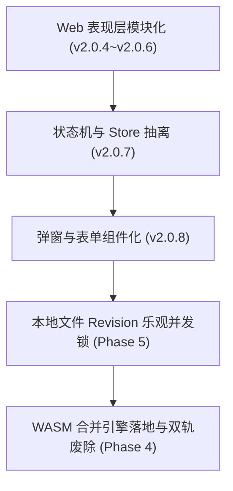

# 2026-11-08 下一步待实现（Antigravity）

## 优先级路线图

---

## 任务详情

### 1. Web 状态机与反应式 Store 抽离（`store.js` / `state.js`）
- **目标**：继续拆解 `apps/codex-tauri/src/main.js`，剥离全局状态与锁状态管理。
- **模块设计**：
  - `store.js` 统一封装：
    - `vaultState`：当前保密库数据（账号、文件夹、历史快照、密码历史）。
    - `lockState`：锁定倒计时、自动锁定计时器（`activityTimer`）、后台模糊挂起与解锁状态。
    - `selectionState`：多选集合（`selectedAccountIds`）、当前激活账号、展开的文件夹。
    - `subscriber` 事件机制：状态变更时通知 UI 渲染切面，解耦直接 DOM 赋值。
- **验收标准**：
  - 单测覆盖锁定倒计时触发、超时清空私密内存、多选状态合并等；
  - 维持 72 命令矩阵与 `scripts/test_all.sh` 100% 绿色。

### 2. 弹窗与交互组件化（`components/dialog.js`）
- **目标**：
  - 将编辑账号弹窗、设置弹窗、同步配置弹窗、OTP 二维码扫码弹窗等大段 DOM 构建逻辑独立化。
  - 标准 Web Component 或纯 ESM 函数渲染，降低 `main.js` 行数至 2000 行以内。

### 3. 本地存储 Revision 乐观并发锁（Phase 5）
- **背景**：
  - 当前多端同步协议已具备严密的 412/428 CAS 校验与 ETag 守卫，但在本地存储层面（Tauri SQLite 与 Pass Web 独立文件），多进程并发读写仍依赖单实例互斥。
- **设计**：
  - 在 `local_vault` / `sqlite` 事务层注入逻辑版本号 `revision`。
  - 写入时执行原子比较交换：`UPDATE metadata SET revision = revision + 1 WHERE revision = ?`，若影响行数为 0 则抛出明确并发冲突错误。

### 4. WASM 合并引擎落地（待网络就绪）
- **规划**：
  - 当明确允许网络下载后，安装 `wasm32-unknown-unknown` 并编译 `pass-merge` 为 WASM；
  - Chrome 扩展与 Web 端全面切换至 WASM 合并引擎，实现三端 100% 绝对一致的单一合并源码。
