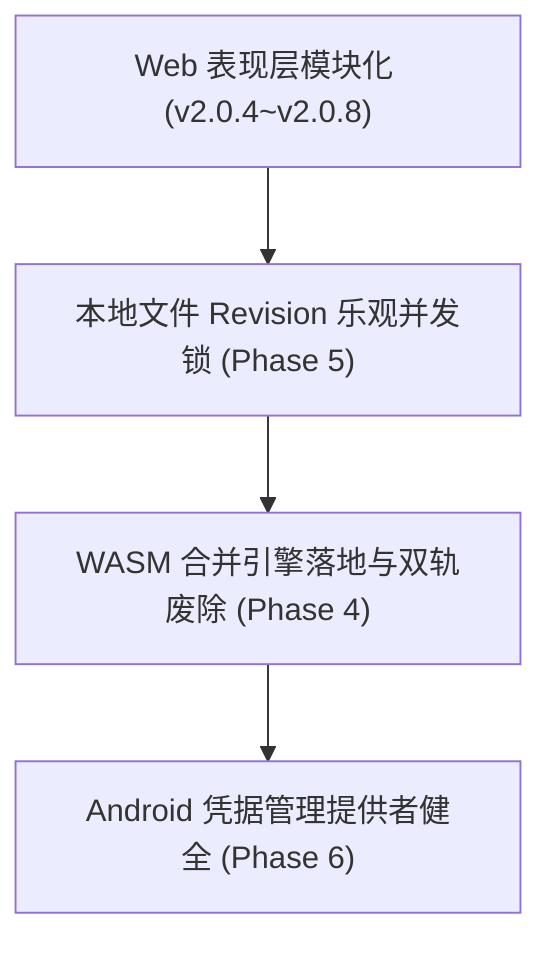

# 2026-11-08 下一步待实现（Antigravity）

## 优先级路线图

---

## 任务详情

### 1. 本地存储 Revision 乐观并发锁（Phase 5）
- **背景**：
  - 当前多端同步协议已具备严密的 412/428 CAS 校验与 ETag 守卫，但在本地存储层面（Tauri SQLite 与 Pass Web 独立文件），多进程并发读写仍依赖单实例互斥。
- **设计**：
  - 在 `local_vault` / `sqlite` 事务层注入逻辑版本号 `revision`。
  - 写入时执行原子比较交换：`UPDATE metadata SET revision = revision + 1 WHERE revision = ?`，若影响行数为 0 则抛出明确并发冲突错误。

### 2. WASM 合并引擎落地（待网络就绪）
- **规划**：
  - 当明确允许网络下载后，安装 `wasm32-unknown-unknown` 并编译 `pass-merge` 为 WASM；
  - Chrome 扩展与 Web 端全面切换至 WASM 合并引擎，实现三端 100% 绝对一致的单一合并源码。

### 3. Android Credential Provider 健全（Phase 6）
- **规划**：
  - 在 `apps/android_credential_provider` 补充真实 vault 解锁与 Passkey/密码提供服务，对齐三端能力标准。
